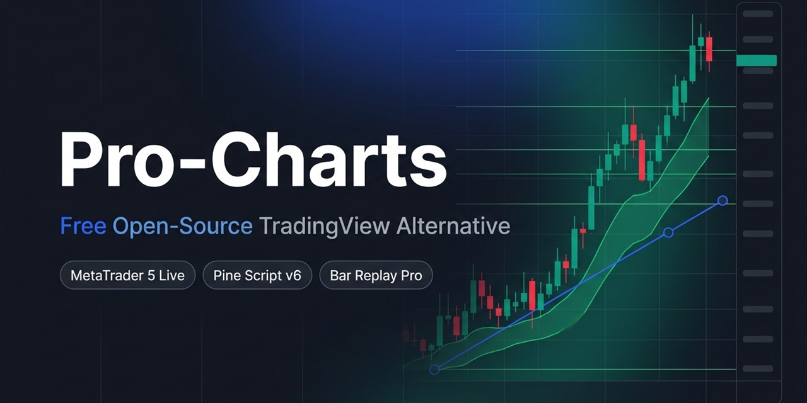
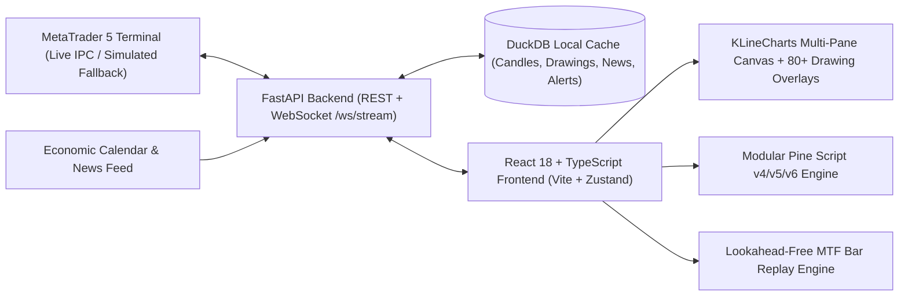

<div align="center">

<a href="https://github.com/daffatahtaa/Pro-Charts">
  
</a>

# ⚡ Pro-Charts

### Free, Open-Source TradingView Alternative Powered by Live MetaTrader 5 Execution & Full Pine Script v6

[](./LICENSE)
[](https://github.com/daffatahtaa/Pro-Charts/actions/workflows/pr.yml)
[](https://github.com/daffatahtaa/Pro-Charts/releases)
[](https://github.com/daffatahtaa/Pro-Charts/stargazers)
[](https://github.com/daffatahtaa/Pro-Charts/network/members)
[](https://github.com/daffatahtaa/Pro-Charts/commits/main)
[](./CONTRIBUTING.md)

[](https://react.dev/)
[](https://www.typescriptlang.org/)
[](https://fastapi.tiangolo.com/)
[](https://www.metatrader5.com/)
[](https://www.tradingview.com/pine-script-docs/)
[](https://duckdb.org/)

**Pro-Charts** is a free, self-hosted, open-source **TradingView alternative** built for Forex, Gold (`XAUUSD`), Crypto, and Indices traders. Stream zero-latency **MetaTrader 5 (MT5)** live WebSocket candles, manage single or **bulk orders (SL/TP & close)** directly from the chart, run custom **Pine Script v4 / v5 / v6** indicators (including `request.security`, `method`, `enum`, `map`, `matrix`), overlay **pair-correlated economic news**, draw with **unlimited drawings** (no 30-drawing account cap), and backtest with lookahead-free **Multi-Timeframe Bar Replay** — with zero monthly subscriptions or paywalls.

[Features](#-core-features) · [vs. TradingView](#-why-pro-charts-pro-charts-vs-tradingview) · [Quick Start](#-quick-start--installation) · [Pine Script v6](#-pine-script-v6-engine-example) · [Architecture](#-architecture--tech-stack) · [Shortcuts](#-keyboard-shortcuts) · [FAQ](#-frequently-asked-questions-faq)

</div>

---

## 📖 Table of Contents

- [Why Pro-Charts? (Pro-Charts vs. TradingView)](#-why-pro-charts-pro-charts-vs-tradingview)
- [Core Features](#-core-features)
- [Pine Script v6 Engine Example](#-pine-script-v6-engine-example)
- [Architecture & Tech Stack](#-architecture--tech-stack)
- [Quick Start & Installation](#-quick-start--installation)
- [Keyboard Shortcuts](#-keyboard-shortcuts)
- [Changelog](#-changelog)
- [Frequently Asked Questions (FAQ)](#-frequently-asked-questions-faq)
- [Contributing & License](#-contributing--community)

---

## ⚖️ Why Pro-Charts? (Pro-Charts vs. TradingView)

Core charting workflows—including **unlimited drawings** (now capped at 30 account-wide on TradingView Basic), intraday Bar Replay, multi-chart split layouts, unlimited custom indicators, and direct MetaTrader 5 execution—are locked behind expensive subscriptions. **Pro-Charts** unlocks them locally and for free:

| Capability | Pro-Charts (Open Source) | TradingView Free Plan | TradingView Paid Plans |
| :--- | :---: | :---: | :---: |
| **Price** | **Free forever (MIT)** | Free (with ads) | $14.95 – $59.95+/month |
| **Total Drawings Limit** | **Unlimited (Local DuckDB)** | **Max 30 drawings (account-wide)** | Tiered / Unlimited |
| **Intraday Bar Replay (1m / 5m / 15m / 1h)** | **Included (Intra-bar MTF)** | Daily+ only | Paid add-on / Essential+ |
| **Multi-Chart Split Layouts (`1 / 2v / 2h / 4`)** | **Up to 4 interactive panes** | 1 chart per tab | Essential / Plus / Premium |
| **Custom Pine Script Indicators** | **Unlimited (`v4 / v5 / v6`)** | Max 2 indicators | 5 – 25+ indicators |
| **Direct MetaTrader 5 Execution & Bulk SL/TP** | **Native MT5 IPC + Bulk Ops** | Not supported natively | Not supported natively |
| **Pair-Correlated Economic News Overlay** | **Included + Bar Replay sync** | Basic calendar markers | Included |
| **Watchlist & Persistent Alerts** | **Unlimited symbols & alerts** | 1 watchlist (30 symbols) | Tiered limits |
| **Built-in Trading Journal & Calendar** | **Myfxbook-style analytics** | Not included | Not included |
| **Privacy & Data Ownership** | **100% Local & Self-Hosted** | Cloud-hosted | Cloud-hosted |

---

## ✨ Core Features

### 📈 Live MetaTrader 5 (MT5) Charting, Execution & Bulk Order Management
- **Zero-Latency WebSocket Streaming** — Live bid/ask tick feeds (`/ws/stream`) with 1-second candle synchronization and local **DuckDB** caching for instant chart reloads.
- **Direct On-Chart Order Execution** — Outlined TradingView-style One-Click `SELL / BUY` legend header, Order Ticket modal, customizable running-trade line styling, thousands-formatted price precision, and interactive on-chart **Stop Loss (SL) / Take Profit (TP)** drag lines.
- **Bulk Set SL/TP & Bulk Close** — Manage multiple positions effortlessly via `All / Pair / Selected` scopes, **per-symbol SL/TP safety guards** (preventing accidental cross-pair price overwrites), drag-to-bulk chart SL/TP lines, bulk close confirmation dialogs, and Paper/Bar Replay support.
- **Multi-Broker & Headless MT5 Support** — Built-in local MT5 server scanner, account switcher, Algo Trading toggle, and **Headless MT5 Cloak Mode** to hide the native MT5 window while trading cleanly in the browser.
- **Built-in Offline / Simulated Mode** — Automatically falls back to a realistic mock market engine when MetaTrader 5 is not running, allowing instant testing on **Windows, macOS, and Linux**.

### 🌲 Full Pine Script v4 / v5 / v6 (`//@version=6`) Engine
- **Modular 4-File Parser & Hybrid Runtime** (`pineTypes`, `pineTaLib`, `pineParser`, `pineRuntime`) running natively in TypeScript at **60 FPS** on live ticks via `calcCache` memoization and adaptive throttling, backed by automated Vitest compatibility tests.
- **Comprehensive Pine v6 Language & MTF Support** — User-Defined Types (`type`), **`method`**, **`enum`**, **`map`**, **`matrix`**, multi-timeframe **`request.security()`**, `if/else`, `switch`, `for`, `while`, `array.*` (including v6 negative indexing), `chart.*`, `timeframe.in_seconds()`, and inline compiler diagnostics.
- **40+ Dynamic Technical Analysis (`ta.*`) Functions** — Full support for multi-output tuples (`ta.supertrend`, `ta.macd`, `ta.bb`, `ta.dmi`, `ta.kc`), `ta.pivothigh/low`, `ta.hma`, `ta.ema/sma/rma/wma`, `ta.crossover/under`, `fixnan`, and Canvas rendering for `box.new` (`xloc.bar_time`), `label.new`, `line.new`, `fill()`, and `plotshape()`.
- **TradingView-Style Indicator Settings Modal (`⚙`)** — Dynamically generates grouped typed controls (`int`, `float`, `bool`, `string` options, `source`, `color`) directly from every `input.*` call in your script, plus 6 ready-to-run `//@version=6` starter templates (*SuperTrend v6 Pro*, *Ichimoku Cloud v6*, *Adaptive MA v6*, *SMC Swing Levels v6*, *MACD v6 Pro*).

### 📰 Pair-Correlated Economic News & Events Overlay
- **Automatic Symbol-to-Currency Correlation** — Strips broker affixes automatically (`XAUUSDm`, `EURUSD.raw`, `GBPUSDc`, `#US30`) and pins correlated economic calendar events along the bottom edge of the chart.
- **Parameterized Controls** — Filter by `High / Medium / Low` impact, correlation scope (`Active pair` vs. `All major` vs. custom currencies), hover/click event detail popovers (`Actual / Forecast / Previous` + live countdown), quick toggle in the bottom status bar, DuckDB caching, and **Bar Replay lookahead masking**.

### ⏪ Free Multi-Timeframe Forex Bar Replay & Paper Trading
- **Deep-History Window Fetching** — Jump to any historical date via `/api/mt5/candles/window` and `/api/mt5/candles/earliest` with `SELECT STARTING POINT` (`Bar`, `Date...` modal with presets, `First available date`, or `Random bar`).
- **Lookahead-Free MTF & Intra-Bar Sub-Steps** — Universal `replayTimeMs` clock aggregates intra-bar sub-candles (`1h` chart stepping realistically by `15m / 5m / 1m`) with zero future data leakage when switching timeframes, viewing economic events, or syncing split-screen panes.
- **Integrated Paper Trading & Backtest Reports** — Place simulated market/limit entries with SL/TP (including bulk SL/TP & bulk close) during Bar Replay and export full session performance statistics.

### ✏️ 80+ Precision Drawing Tools (Unlimited — No 30-Drawing Limit)
- **Complete Technical Analysis Drawing Suite** — Trendlines, Rays, Parallel Channels, **8-handle resizable Rectangles**, **unlimited-point Path tool**, Fibonacci Retracements & Extensions, Gann tools, Pitchforks, Elliott Waves, Brushes, Text/Callouts, Icons/Stickers, Ruler, and **3-Pill Risk/Reward Long & Short Position** tools with hover/select stats and entry-hit visuals.
- **Universal Opacity, Strict Lock & Z-Order Preservation** — Per-tool opacity controls, strict drawing locks that prevent accidental moves or deletions, preserved z-order when hiding/unhiding drawings, and safe right-click context menus.
- **Multi-Select Marquee, Grouping & Angle Lock** — `Ctrl + Drag` translucent selection marquee with persistent TradingView anchor handles, `Ctrl + G` / `Ctrl + Shift + G` grouping, collapsible **Object Tree** group folders, and **`Shift`-Hold `0° / 45° / 90°` Angle Lock**.

### 🖥️ Interactive Multi-Chart Layouts, UI Scaling, HiDPI Snapshots & Trading Journal
- **Interactive Multi-Chart Split Grids** — `1 / 2v / 2h / 4` layouts with full drawing tools, live Bid/Ask lines & price labels, and unambiguous pane selection on **every secondary chart pane**, synced seamlessly with live feeds and Bar Replay.
- **Canvas-Safe UI Scale & Fullscreen Mode (`[ ⛶ ]`)** — Adjust overall interface scaling cleanly without distorting chart canvases, plus distraction-free fullscreen (`Shift + F`).
- **HiDPI Chart Snapshots (`[ 📷 ]`) & Myfxbook-Style Analytics** — Composite PNG snapshot exporter (`Download image`, `Copy image`, `Copy link` via `POST /api/snapshots`, `Open in new tab`, `Post image` to `𝕏`), drag-reorderable Watchlist, audio price alerts, equity curve analytics, trade tagging, and a daily P&L Trading Calendar.

---

## 🧪 Pine Script v6 Engine Example

Paste and run native TradingView `//@version=6` scripts directly inside **Pro-Charts** — complete with `input.*` settings modals, tuple destructuring, cloud fills, and buy/sell signals:

```pine
//@version=6
indicator("SuperTrend v6 Pro", shorttitle="ST6", overlay=true)
factor = input.float(3.0, "Factor")
atrPeriod = input.int(10, "ATR Length")

[supertrend, direction] = ta.supertrend(factor, atrPeriod)

upTrend = plot(direction < 0 ? supertrend : na, "Up Trend", color = color.green, style = plot.style_linebr, linewidth = 2)
downTrend = plot(direction > 0 ? supertrend : na, "Down Trend", color = color.red, style = plot.style_linebr, linewidth = 2)
bodyMid = plot(hl2, "Mid", display = display.none)

fill(bodyMid, upTrend, color = color.new(color.green, 88))
fill(bodyMid, downTrend, color = color.new(color.red, 88))

plotshape(ta.crossunder(direction, 0), title="Buy", style=shape.triangleup, location=location.belowbar, color=color.green, text="BUY")
plotshape(ta.crossover(direction, 0), title="Sell", style=shape.triangledown, location=location.abovebar, color=color.red, text="SELL")
```

---

## 🏗️ Architecture & Tech Stack



| Layer | Technologies |
| :--- | :--- |
| **Frontend UI & State** | React 18, TypeScript 5, Vite 5, Tailwind CSS 3, Zustand 4, Lucide Icons |
| **Charting & Overlays** | KLineCharts 9, Custom Multi-Pane Canvas Overlays, News Event Overlay, HiDPI PNG Snapshot Engine |
| **Scripting Engine** | Custom TypeScript Pine Script v4 / v5 / v6 Lexer, AST Parser, `ta.*` Library, `request.security`, Memoized Runtime |
| **Backend API & Streaming** | Python 3.10+, FastAPI, Uvicorn, WebSockets, Pydantic, httpx, NumPy |
| **Broker Bridge & Storage** | Official `MetaTrader5` Python IPC Library, DuckDB Embedded Analytics Database |
| **Testing & CI** | Pytest (backend bulk trading, drawing order & news), Vitest (Pine Script v6 suite), GitHub Actions |

---

## 🚀 Quick Start & Installation

### Prerequisites

- **Node.js** `18+` & **npm**
- **Python** `3.10+`
- **MetaTrader 5** terminal (Windows, optional for live trading — **Pro-Charts** automatically falls back to a built-in simulated market feed when MT5 is offline or on macOS/Linux)

### Option 1 — One-Click Launcher (Windows)

```bat
git clone https://github.com/daffatahtaa/Pro-Charts.git
cd Pro-Charts
start-dev.bat
```

> First run: the launcher automatically creates `backend/.venv` and installs both Python (`pip`) and frontend (`npm`) dependencies.

### Option 2 — Manual Setup (Windows / macOS / Linux)

**1. Clone the repository**
```bash
git clone https://github.com/daffatahtaa/Pro-Charts.git
cd Pro-Charts
```

**2. Start the Backend (FastAPI + DuckDB + MT5 Bridge)**
```powershell
cd backend
python -m venv .venv
.\.venv\Scripts\activate      # macOS/Linux: source .venv/bin/activate
pip install -r requirements.txt
uvicorn main:app --reload --port 8000
```

**3. Start the Frontend (Vite + React + TypeScript)**
```powershell
cd frontend
npm install
npm run dev
```

Open **`http://localhost:5173`** in your browser and start charting!

---

## ⌨️ Keyboard Shortcuts

| Shortcut | Action |
| :--- | :--- |
| `Ctrl + K` | Open Symbol Search |
| `Shift` (hold while drawing) | Lock drawing angle to `0° / 45° / 90°` |
| `Ctrl + Drag` | Multi-select drawings marquee box |
| `Ctrl + G` / `Ctrl + Shift + G` | Group / Ungroup selected drawings |
| `Shift + F` / `Esc` | Toggle / Exit Fullscreen mode |
| `Ctrl + Alt + S` | Download chart snapshot (HiDPI PNG) |
| `Ctrl + Shift + S` | Copy chart snapshot image to clipboard |
| `Alt + S` | Copy shareable chart snapshot link |
| `Ctrl + Z` / `Ctrl + Y` | Undo / Redo drawing |
| `Space` / `Shift + →` / `Shift + ←` | Bar Replay Play/Pause / Step Forward / Step Back |

---

## 📜 Changelog

See the full release history in [`CHANGELOG.md`](./CHANGELOG.md).

### 🔥 Last 5 Major Releases

- **`v2.6.0` — Bulk Order Management, Full Pine v6 Compatibility, Pair-Correlated News & Multi-Chart Drawing Suite**
  - Expanded Pine Script v6 engine (`method`, `enum`, `map`, `matrix`, MTF `request.security`, dynamic `ta.*`, diagnostics) with Vitest coverage.
  - Added pair-correlated bottom chart economic news overlay (`ChartNewsOverlay` + `news_service.py`) with impact filters and Bar Replay lookahead masking.
  - Added per-symbol safe Bulk Set SL/TP, Bulk Close, drag-to-bulk SL/TP lines, interactive secondary multi-chart drawings + live Bid/Ask lines, universal drawing opacity, 8-handle rectangle resize, unlimited Path points, strict locks, z-order preservation, UI scaling, and GitHub Actions CI.
- **`v2.5.0` — Shift-Hold Angle Lock, Fullscreen Mode & HiDPI Chart Snapshot**
  - Global `Shift`-hold `0° / 45° / 90°` angle snapping across directional drawing tools & anchor handles.
  - TradingView Fullscreen Mode (`[ ⛶ ]` / `Shift + F`) with native browser fullscreen sync and floating hover controls.
  - `[ 📷 ]` `CHART SNAPSHOT` dropdown & composite HiDPI PNG exporter (`Download image`, `Copy image`, `Copy link` via `POST /api/snapshots`, `Open in new tab`, `Post image` to `𝕏`).
- **`v2.4.0` — Pine Script v6 (`//@version=6`) Engine & Indicator Settings Modal**
  - Modular 4-file Pine Script v6 engine (`pineTypes`, `pineTaLib`, `pineParser`, `pineRuntime`) with 40+ `ta.*` functions, tuple destructuring, User-Defined Types (`type`), `if`/`switch`/`for`/`while`, `array.*` negative indexing, `box.new` & `label.new` Canvas rendering, and 6 starter templates.
  - TradingView-style **Indicator Settings (`⚙`)** modal with grouped typed controls directly from the chart legend.
- **`v2.3.0` — TradingView Bar Replay Pro (Deep History, Intra-Bar & Lookahead-Free MTF)**
  - Backend `/api/mt5/candles/window` & `/api/mt5/candles/earliest` endpoints for arbitrary historical date jumps.
  - Universal `replayTimeMs` clock, intra-bar sub-candle aggregation (`1h → 15m/5m/1m`), auto-extending forward buffer, lookahead-free MTF switching, split-screen secondary pane sync, and `SELECT STARTING POINT` toolbar & `Date...` modal.
- **`v2.2.0` — `Ctrl + Drag` Multi-Select Marquee, Drawing Grouping & Boxless Labels**
  - `Ctrl + Drag` blue translucent marquee selection with persistent anchor handles, `Ctrl + G` / `Ctrl + Shift + G` grouping, Object Tree group folders, and batch actions.
  - Boxless TradingView drawing typography with centered line-splitting on horizontal lines and 1px hairline rendering.

### 🛠️ Latest 3 Minor Revisions

- **`v2.5.3` — Pine v6 `xloc.bar_time` Canvas Projection & Auto Chart-TF Detection** — Binary-search timestamp interpolation for `box.new` / `label.new` (`xloc.bar_time`) and automatic chart timeframe detection (`detectedChartSec`) for `timeframe.in_seconds()`.
- **`v2.5.2` — Pine v6 Performance Optimization (13.4× Speedup & 60 FPS Live Ticks)** — `calcCache` memoization with adaptive live-tick throttling (`0 ms` on intermediate ticks) and zero-allocation `BarExecCtx` + 550-bar tail windowing.
- **`v2.5.1` — Persistent Multi-Select Handles & Pine v6 Built-in Compatibility** — Continuously lit selection handles after `mouseup`, plus `chart.*` namespace, `color.r/g/b`, inline `input.*(...)` extraction, type-cast helpers, and nested `if`/`break`/`continue`.

---

## ❓ Frequently Asked Questions (FAQ)

### Is Pro-Charts really a free TradingView alternative with unlimited drawings?
Yes. Pro-Charts is 100% open source under the [MIT License](./LICENSE). Unlike TradingView's Basic plan (which caps accounts at **30 total drawings**, 2 indicators per chart, and Daily+ Bar Replay), Pro-Charts stores everything locally in DuckDB with **unlimited drawings, unlimited indicators, 4-pane split layouts, and intraday Bar Replay** for free.

### Does Pro-Charts require a MetaTrader 5 account to run?
No. While live market feeds and direct order execution (including Bulk Set SL/TP and Bulk Close) connect to any local **MetaTrader 5** demo or live broker account on Windows, Pro-Charts includes a built-in **Simulated Market Engine** fallback so you can test charting, Pine Script v6, drawings, news overlays, and Bar Replay immediately without MT5 installed.

### Can I paste TradingView Pine Script v6 indicators into Pro-Charts?
Yes. Pro-Charts includes a custom Pine Script v4 / v5 / v6 parser and execution runtime supporting `method`, `enum`, `map`, `matrix`, multi-timeframe `request.security()`, 40+ `ta.*` functions, tuple destructuring, User-Defined Types (`type`), arrays, `box.new`, `label.new`, `line.new`, `fill()`, `plotshape()`, compiler diagnostics, and automatic `input.*` settings modals.

### Does Bar Replay work across multiple timeframes without lookahead bias?
Yes. Bar Replay uses a single universal `replayTimeMs` clock with intra-bar sub-candle aggregation (`1h` stepping by `15m / 5m / 1m`), preventing future candles or future economic news `Actual` values from leaking when switching timeframes or viewing multi-chart split layouts.

### Can I run Pro-Charts on macOS or Linux?
Yes. The React + TypeScript frontend and FastAPI + DuckDB backend run natively on Windows, macOS, and Linux (using the simulated market feed on non-Windows platforms where MetaTrader 5's native Python IPC library is unavailable).

---

## 🤝 Contributing & Community

Contributions, bug reports, Pine Script v6 indicator templates, and feature requests are always welcome!

- Read our [Contributing Guide](./CONTRIBUTING.md) and [Code of Conduct](./CODE_OF_CONDUCT.md)
- Report bugs or suggest features in [GitHub Issues](https://github.com/daffatahtaa/Pro-Charts/issues)
- Join Q&A and ideas in [GitHub Discussions](https://github.com/daffatahtaa/Pro-Charts/discussions)
- Review our [Security Policy](./SECURITY.md) before live trading

## 📄 License

Distributed under the **MIT License**. See [`LICENSE`](./LICENSE) for details.

> **Disclaimer:** Pro-Charts is open-source charting and trade-execution software provided for educational and analytical purposes. Trading Forex, CFDs, and financial instruments involves significant risk of loss. Always test strategies and MT5 execution on a demo account first.

---

<div align="center">

If **Pro-Charts** saves you money on charting subscriptions or levels up your MT5 workflow, consider giving the repo a **⭐ Star** on GitHub!

</div>
